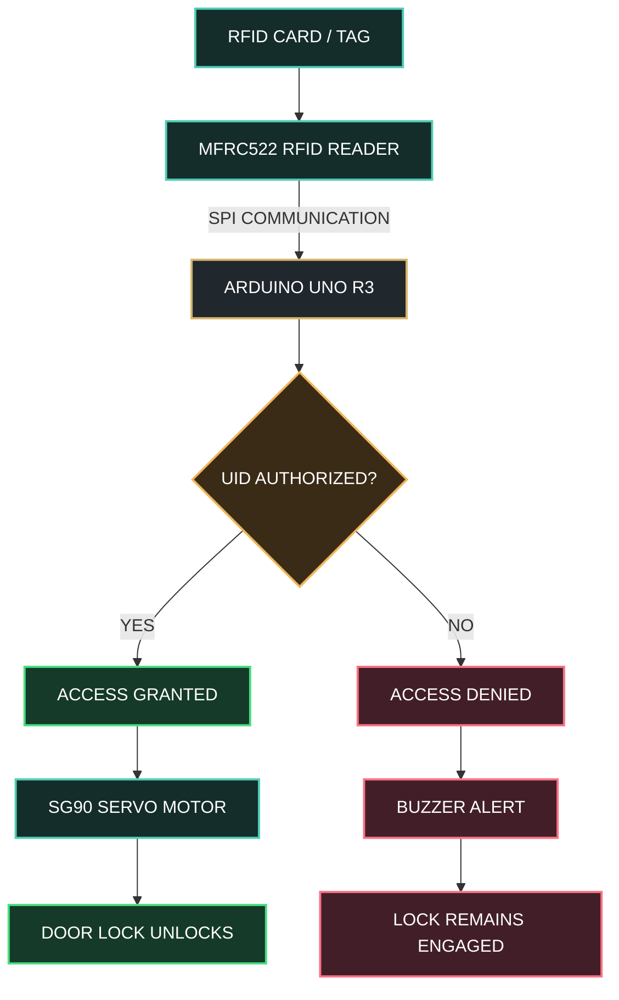

# ⬡ RFID SMART ACCESS CONTROL SYSTEM

### INTELLIGENT SECURITY • EMBEDDED SYSTEMS • AUTOMATED ACCESS

 

 

**SCAN → AUTHENTICATE → UNLOCK**

 

 

`ARDUINO UNO` &nbsp; • &nbsp; `MFRC522 RFID` &nbsp; • &nbsp; `SG90 SERVO` &nbsp; • &nbsp; `ACCESS CONTROL`

**Designed & Developed by Ahmed Bader Eddine Benkhira**

## ═══ 01 · PROJECT OVERVIEW ═══

### 1.1 Introduction

Access control is an essential component of modern security systems used in residential buildings, laboratories, offices, industrial facilities, and restricted areas. Traditional mechanical keys provide a simple method of entry, but they can be lost, duplicated, or transferred between individuals without centralized authorization.

The **RFID Smart Access Control System** introduces a contactless alternative based on Radio-Frequency Identification (RFID). The system enables a user to present an RFID card or tag to a reader installed near a door. A microcontroller reads the card identifier, evaluates it against a predefined authorization list, and determines whether access should be granted or denied.

An authorized card activates a servo motor that simulates the unlocking mechanism. An unauthorized card leaves the system locked and may trigger an audible warning through a buzzer.

The prototype is implemented using an Arduino UNO, an MFRC522 RFID reader, an SG90 servo motor, and optional status indicators. It combines hardware interfacing, embedded C++ programming, digital communication, state-based control, and experimental validation in one integrated engineering project.

### 1.2 Project Objectives

The primary objectives are:

- Develop a contactless identification system using RFID technology.
- Interface an MFRC522 reader with an Arduino UNO through SPI communication.
- Implement an authorization algorithm based on registered card identifiers.
- Control a servo motor to simulate door locking and unlocking.
- Provide feedback for successful and unsuccessful authentication.
- Evaluate response time, reliability, usability, and operational limitations.
- Establish a foundation for future enhancements involving secure credentials, event logging, and network connectivity.

### 1.3 Project Scope

This implementation focuses on a low-cost, educational access-control prototype. The servo represents a small locking mechanism or model door rather than a full-size physical security lock.

The baseline design operates locally without requiring an internet connection, cloud service, or external database.

---

## ═══ 02 · SYSTEM ARCHITECTURE ═══

### 2.1 High-Level Architecture

The system consists of four principal functional layers:

1. **Identification Layer:** The RFID card communicates with the MFRC522 reader.
2. **Processing Layer:** The Arduino reads the card UID and performs the authorization check.
3. **Actuation Layer:** The servo motor changes between locked and unlocked positions.
4. **Feedback Layer:** LEDs and an optional buzzer communicate the authentication result.

---

----------------------------------------------------------------------------------------------------------------
----------------------------------------------------------------------------------------------------------------
-----------------------------------ben khira ahmed bader eddine-------------------------------------------------
----------------------------------------------------------------------------------------------------------------
----------------------------------------------------------------------------------------------------------------

##  Hardware Components
- Arduino UNO
- MFRC522 RFID Reader (SPI)
- SG90 Servo Motor
- Buzzer (optional)
- RFID Cards / Tags
- Breadboard & Jumper Wires

----------------------------------------------------------------------------------------------------------------
----------------------------------------------------------------------------------------------------------------

##  System Architecture

1. RFID card is scanned
2. Arduino reads UID
3. UID is compared with authorized list
4. If matched → Door unlocks
5. If not matched → Access denied alert

----------------------------------------------------------------------------------------------------------------
----------------------------------------------------------------------------------------------------------------

##  Features
- Multi-card authentication
- Automatic re-lock after timeout
- Unauthorized access detection
- Modular structured code
- Expandable system design

----------------------------------------------------------------------------------------------------------------
----------------------------------------------------------------------------------------------------------------

##  Technologies Used
- C++ (Arduino IDE)
- Embedded Systems Programming
- SPI Communication Protocol
- Servo Motor Control

----------------------------------------------------------------------------------------------------------------
----------------------------------------------------------------------------------------------------------------
-----------------------------------ben khira ahmed bader eddine-------------------------------------------------
----------------------------------------------------------------------------------------------------------------
----------------------------------------------------------------------------------------------------------------

##  Future Improvements
- EEPROM-based dynamic card registration
- LCD display integration
- IoT remote monitoring (ESP32)
- Access logging system

----------------------------------------------------------------------------------------------------------------
----------------------------------------------------------------------------------------------------------------
-----------------------------------ben khira ahmed bader eddine-------------------------------------------------
----------------------------------------------------------------------------------------------------------------
----------------------------------------------------------------------------------------------------------------

##  Author
Ahmed Bader Eddine  
Bachelor Graduate  
GitHub: https://github.com/BenkhiraAhmedBaderEddine1
