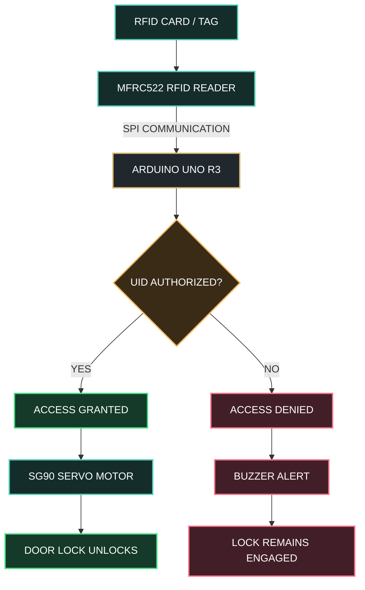

# ⬡ RFID SMART ACCESS CONTROL SYSTEM

### INTELLIGENT SECURITY • EMBEDDED SYSTEMS • AUTOMATED ACCESS

 

 

**SCAN → AUTHENTICATE → UNLOCK**

 

 

`ARDUINO UNO` &nbsp; • &nbsp; `MFRC522 RFID` &nbsp; • &nbsp; `SG90 SERVO` &nbsp; • &nbsp; `ACCESS CONTROL`

**Designed & Developed by Ahmed Bader Eddine Benkhira**

<svg xmlns="http://www.w3.org/2000/svg" width="1000" height="480" viewBox="0 0 1000 480">
  <defs>
    <linearGradient id="bg" x1="0" y1="0" x2="1" y2="1">
      <stop offset="0%" stop-color="#0b1115"/>
      <stop offset="100%" stop-color="#172522"/>
    </linearGradient>
    <linearGradient id="gold" x1="0" y1="0" x2="1" y2="1">
      <stop offset="0%" stop-color="#f8e6a0"/>
      <stop offset="100%" stop-color="#b58a3b"/>
    </linearGradient>
    <linearGradient id="door" x1="0" y1="0" x2="1" y2="1">
      <stop offset="0%" stop-color="#285443"/>
      <stop offset="100%" stop-color="#10271f"/>
    </linearGradient>
    <filter id="glow">
      <feGaussianBlur stdDeviation="5" result="blur"/>
      <feMerge><feMergeNode in="blur"/><feMergeNode in="SourceGraphic"/></feMerge>
    </filter>
  </defs>

  <rect width="1000" height="480" rx="18" fill="url(#bg)"/>

  <text x="500" y="45" text-anchor="middle" fill="#f4d88b"
        font-family="Arial,sans-serif" font-size="25" letter-spacing="4">
    RFID SMART ACCESS
  </text>
  <text x="500" y="72" text-anchor="middle" fill="#a6b7af"
        font-family="Arial,sans-serif" font-size="13" letter-spacing="2">
    CONTACTLESS AUTHENTICATION SYSTEM
  </text>

  <!-- Floor -->
  <path d="M55 390 H945" stroke="#8c7546" stroke-width="2" opacity=".65"/>
  <path d="M100 390 L70 430 M900 390 L930 430"
        stroke="#8c7546" stroke-width="1" opacity=".25"/>

  <!-- Door frame -->
  <rect x="570" y="115" width="230" height="275" rx="3"
        fill="none" stroke="url(#gold)" stroke-width="5"/>
  <path d="M570 115 V390" stroke="#f4d88b" stroke-width="4"/>

  <!-- Door leaf swings open after card scan -->
  <g>
    <rect x="575" y="120" width="215" height="265" rx="2"
          fill="url(#door)" stroke="#d5b567" stroke-width="2">
      <animateTransform attributeName="transform" type="rotate"
        values="0 575 252;0 575 252;-48 575 252;-48 575 252;0 575 252"
        keyTimes="0;0.25;0.42;0.76;1"
        dur="8s" repeatCount="indefinite"/>
    </rect>
    <g>
      <animateTransform attributeName="transform" type="rotate"
        values="0 575 252;0 575 252;-48 575 252;-48 575 252;0 575 252"
        keyTimes="0;0.25;0.42;0.76;1"
        dur="8s" repeatCount="indefinite"/>
      <circle cx="755" cy="255" r="6" fill="#f2d48a"/>
      <path d="M755 255 h-8" stroke="#f2d48a" stroke-width="3"/>
    </g>
  </g>

  <!-- Person -->
  <g stroke="#d9e3dc" stroke-width="5" stroke-linecap="round" stroke-linejoin="round">
    <circle cx="205" cy="170" r="28" fill="#c9a16b" stroke="none"/>
    <path d="M181 165 Q180 135 207 139 Q231 140 232 165"
          fill="#26332e" stroke="none"/>
    <path d="M205 201 V292" stroke="#d6b46c" stroke-width="42"/>
    <path d="M205 222 L267 244 L310 226" fill="none" stroke-width="13"/>
    <path d="M190 292 L176 376 M220 292 L240 376"
          fill="none" stroke-width="17"/>
    <path d="M163 380 H187 M229 380 H252" stroke-width="10"/>
  </g>

  <!-- RFID card in person's hand -->
  <g>
    <rect x="294" y="208" width="48" height="34" rx="4"
          fill="#162f2a" stroke="#f4d88b" stroke-width="2">
      <animateTransform attributeName="transform" type="translate"
        values="0 0;12 0;12 0;0 0" keyTimes="0;0.25;0.65;1"
        dur="8s" repeatCount="indefinite"/>
    </rect>
    <path d="M305 219 h25 M305 225 h17"
          stroke="#f4d88b" stroke-width="2">
      <animateTransform attributeName="transform" type="translate"
        values="0 0;12 0;12 0;0 0" keyTimes="0;0.25;0.65;1"
        dur="8s" repeatCount="indefinite"/>
    </path>
  </g>

  <!-- RFID reader -->
  <rect x="405" y="200" width="82" height="115" rx="9"
        fill="#101817" stroke="#c9a45c" stroke-width="3"/>
  <rect x="416" y="211" width="60" height="93" rx="5"
        fill="#1c332b" stroke="#496e58" stroke-width="1"/>
  <circle cx="446" cy="230" r="5" fill="#f2c96d">
    <animate attributeName="fill" values="#f2c96d;#5af0a2;#f2c96d"
             dur="2s" repeatCount="indefinite"/>
  </circle>
  <path d="M434 248 Q446 237 458 248 M429 254 Q446 237 463 254"
        fill="none" stroke="#d6b66b" stroke-width="2" opacity=".9"/>
  <text x="446" y="282" text-anchor="middle" fill="#f3dfaa"
        font-family="Arial,sans-serif" font-size="10">RFID</text>

  <!-- Scanning waves -->
  <g fill="none" stroke="#63e6ad" stroke-width="2" filter="url(#glow)">
    <circle cx="397" cy="255" r="15" opacity="0">
      <animate attributeName="r" values="10;45" dur="2s" repeatCount="indefinite"/>
      <animate attributeName="opacity" values=".9;0" dur="2s" repeatCount="indefinite"/>
    </circle>
    <circle cx="397" cy="255" r="15" opacity="0">
      <animate attributeName="r" values="10;45" dur="2s" begin="1s" repeatCount="indefinite"/>
      <animate attributeName="opacity" values=".9;0" dur="2s" begin="1s" repeatCount="indefinite"/>
    </circle>
  </g>

  <!-- Access status -->
  <rect x="360" y="340" width="180" height="31" rx="15"
        fill="#16382a" stroke="#4cbd83" stroke-width="1"/>
  <text x="450" y="360" text-anchor="middle" fill="#8ff0b8"
        font-family="Arial,sans-serif" font-size="12" font-weight="bold">
    ACCESS GRANTED
    <animate attributeName="opacity" values="1;.55;1"
             dur="1.8s" repeatCount="indefinite"/>
  </text>

  <!-- Controller label -->
  <text x="446" y="335" text-anchor="middle" fill="#b9c8bf"
        font-family="Arial,sans-serif" font-size="10">MFRC522</text>

  <text x="205" y="420" text-anchor="middle" fill="#f1d58b"
        font-family="Arial,sans-serif" font-size="14" letter-spacing="2">
    PRESENT CARD
  </text>
  <text x="446" y="420" text-anchor="middle" fill="#f1d58b"
        font-family="Arial,sans-serif" font-size="14" letter-spacing="2">
    VERIFY UID
  </text>
  <text x="685" y="420" text-anchor="middle" fill="#f1d58b"
        font-family="Arial,sans-serif" font-size="14" letter-spacing="2">
    DOOR UNLOCKS
  </text>

  <text x="500" y="458" text-anchor="middle" fill="#7e9488"
        font-family="Arial,sans-serif" font-size="11" letter-spacing="2">
    ARDUINO UNO • RFID • SERVO MOTOR
  </text>
</svg>

## ◈ 01 — PROJECT OVERVIEW

The **RFID Smart Access Control System** is an embedded security prototype designed to demonstrate contactless identification and automated access control using an Arduino UNO and an MFRC522 RFID reader.

When an RFID card is presented, the reader retrieves its unique identifier (UID). The Arduino compares it with a predefined list of authorized cards. If the UID is authorized, an SG90 servo motor moves the demonstration lock to its unlocked position. Otherwise, access is denied and an optional buzzer can provide an alert.

The project combines RFID communication, embedded C++, authentication logic, and electromechanical actuation in a compact access-control prototype.

---

## ◈ 02 — SYSTEM ARCHITECTURE

---

# Arduino-RFID-Door-Lock-System
An automated RFID-based physical security system engineered with Arduino UNO. Features a MFRC522 sensing interface for UID-validated entry and a servo-actuated locking mechanism for hands-free access control
#  RFID Smart Access Control System

      _________________________________________________
      |                                                |
      |          Arduino RFID Access Control           |
      |________________________________________________|
               |                                |
      [ RFID SCANNER ]                  [ SERVO MOTOR ]
      |    (MFRC522)   |                  |  (Lock Mech)  |
      |   __________   |                  |      ____     |
      |  |  ( (●) ) |  |       ____       |     /    \    |
      |  |   SCAN   |  |------|    |------|    | STOP |   |
      |  |   HERE   |  |      |UNO |      |     \____/    |
      |  |__________|  |      |____|      |      _||_     |
      |________________|        ||        |_____|____|____|
                                ||
                        [ BUZZER / LEDS ]
                         (Status Indicators)

          Key:   [*] Authorized Tag -> Servo Rotates (Open)
                 [!] Unauthorized   -> Buzzer Alarms (Locked)

                 

##  Project Overview
This project presents the design and implementation of a secure RFID-based access control system using Arduino UNO and MFRC522 RFID module.

The system grants access only to authorized RFID cards and controls a servo motor to simulate a door locking mechanism.

----------------------------------------------------------------------------------------------------------------
----------------------------------------------------------------------------------------------------------------
-----------------------------------ben khira ahmed bader eddine-------------------------------------------------
----------------------------------------------------------------------------------------------------------------
----------------------------------------------------------------------------------------------------------------

##  Hardware Components
- Arduino UNO
- MFRC522 RFID Reader (SPI)
- SG90 Servo Motor
- Buzzer (optional)
- RFID Cards / Tags
- Breadboard & Jumper Wires

----------------------------------------------------------------------------------------------------------------
----------------------------------------------------------------------------------------------------------------

##  System Architecture

1. RFID card is scanned
2. Arduino reads UID
3. UID is compared with authorized list
4. If matched → Door unlocks
5. If not matched → Access denied alert

----------------------------------------------------------------------------------------------------------------
----------------------------------------------------------------------------------------------------------------

##  Features
- Multi-card authentication
- Automatic re-lock after timeout
- Unauthorized access detection
- Modular structured code
- Expandable system design

----------------------------------------------------------------------------------------------------------------
----------------------------------------------------------------------------------------------------------------

##  Technologies Used
- C++ (Arduino IDE)
- Embedded Systems Programming
- SPI Communication Protocol
- Servo Motor Control

----------------------------------------------------------------------------------------------------------------
----------------------------------------------------------------------------------------------------------------
-----------------------------------ben khira ahmed bader eddine-------------------------------------------------
----------------------------------------------------------------------------------------------------------------
----------------------------------------------------------------------------------------------------------------

##  Future Improvements
- EEPROM-based dynamic card registration
- LCD display integration
- IoT remote monitoring (ESP32)
- Access logging system

----------------------------------------------------------------------------------------------------------------
----------------------------------------------------------------------------------------------------------------
-----------------------------------ben khira ahmed bader eddine-------------------------------------------------
----------------------------------------------------------------------------------------------------------------
----------------------------------------------------------------------------------------------------------------

##  Author
Ahmed Bader Eddine  
Bachelor Graduate  
GitHub: https://github.com/BenkhiraAhmedBaderEddine1
