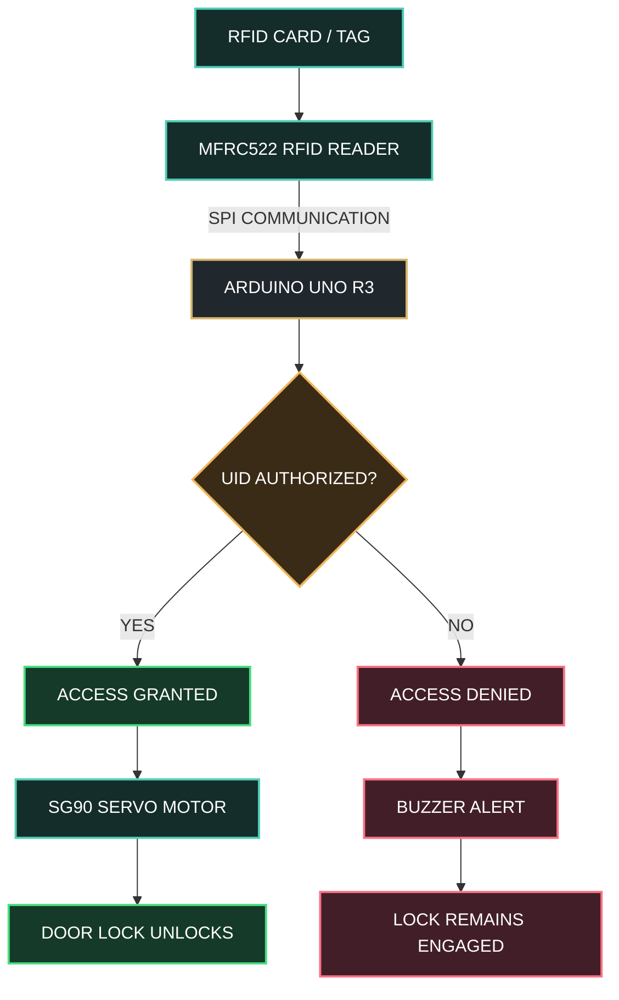

# ⬡ RFID SMART ACCESS CONTROL SYSTEM

### INTELLIGENT SECURITY • EMBEDDED SYSTEMS • AUTOMATED ACCESS

 

 

**SCAN → AUTHENTICATE → UNLOCK**

 

 

`ARDUINO UNO` &nbsp; • &nbsp; `MFRC522 RFID` &nbsp; • &nbsp; `SG90 SERVO` &nbsp; • &nbsp; `ACCESS CONTROL`

**Designed & Developed by Ahmed Bader Eddine Benkhira**

## ═══ 01 · PROJECT OVERVIEW ═══

### 1.1 Introduction

Access control is an essential component of modern security systems used in residential buildings, laboratories, offices, industrial facilities, and restricted areas. Traditional mechanical keys provide a simple method of entry, but they can be lost, duplicated, or transferred between individuals without centralized authorization.

The **RFID Smart Access Control System** introduces a contactless alternative based on Radio-Frequency Identification (RFID). The system enables a user to present an RFID card or tag to a reader installed near a door. A microcontroller reads the card identifier, evaluates it against a predefined authorization list, and determines whether access should be granted or denied.

An authorized card activates a servo motor that simulates the unlocking mechanism. An unauthorized card leaves the system locked and may trigger an audible warning through a buzzer.

The prototype is implemented using an Arduino UNO, an MFRC522 RFID reader, an SG90 servo motor, and optional status indicators. It combines hardware interfacing, embedded C++ programming, digital communication, state-based control, and experimental validation in one integrated engineering project.

### 1.2 Project Objectives

The primary objectives are:

- Develop a contactless identification system using RFID technology.
- Interface an MFRC522 reader with an Arduino UNO through SPI communication.
- Implement an authorization algorithm based on registered card identifiers.
- Control a servo motor to simulate door locking and unlocking.
- Provide feedback for successful and unsuccessful authentication.
- Evaluate response time, reliability, usability, and operational limitations.
- Establish a foundation for future enhancements involving secure credentials, event logging, and network connectivity.

### 1.3 Project Scope

This implementation focuses on a low-cost, educational access-control prototype. The servo represents a small locking mechanism or model door rather than a full-size physical security lock.

The baseline design operates locally without requiring an internet connection, cloud service, or external database.

---

## ═══ 02 · SYSTEM ARCHITECTURE ═══

### 2.1 High-Level Architecture

The system consists of four principal functional layers:

1. **Identification Layer:** The RFID card communicates with the MFRC522 reader.
2. **Processing Layer:** The Arduino reads the card UID and performs the authorization check.
3. **Actuation Layer:** The servo motor changes between locked and unlocked positions.
4. **Feedback Layer:** LEDs and an optional buzzer communicate the authentication result.

---

----------------------------------------------------------------------------------------------------------------
----------------------------------------------------------------------------------------------------------------
-----------------------------------ben khira ahmed bader eddine-------------------------------------------------
----------------------------------------------------------------------------------------------------------------
----------------------------------------------------------------------------------------------------------------

### 2.2 Operating Principle

The process begins when an RFID card enters the reader's operating field. The MFRC522 detects the card and obtains its identifier through the RFID protocol.

The Arduino receives the identifier, compares it with the configured list of authorized UIDs, and selects the corresponding response.

If the identifier matches an entry in the list, the controller activates the servo to simulate unlocking. After a configurable interval, the servo returns to its locked position.

If no match is found, the controller denies access and optionally activates a buzzer.

**Important:** The baseline implementation checks a card UID. It does not perform cryptographic card authentication, maintain a permanent audit trail, or guarantee protection against cloned cards.

---

## ═══ 03 · HARDWARE COMPONENTS ═══

### 3.1 Bill of Materials

| No. | Component | Quantity | Function |
|:--:|---|:--:|---|
| 1 | Arduino UNO R3 | 1 | Main microcontroller |
| 2 | MFRC522 RFID reader | 1 | Reads RFID cards and tags |
| 3 | Compatible RFID card or tag | 1+ | Contactless credential |
| 4 | SG90 servo motor | 1 | Simulates the locking mechanism |
| 5 | Active buzzer | 1 | Optional denial notification |
| 6 | Red LED | 1 | Optional access-denied indicator |
| 7 | Green LED | 1 | Optional access-granted indicator |
| 8 | 220–330 Ω LED resistors | 2 | Limit LED current |
| 9 | Breadboard | 1 | Prototype assembly |
| 10 | Jumper wires | As needed | Electrical connections |
| 11 | USB cable | 1 | Programming and power |
| 12 | External regulated supply | As required | Servo power when needed |

The exact number of components depends on the selected configuration. LEDs and the buzzer are optional additions.

### 3.2 Required Software

- Arduino IDE
- Arduino AVR board support
- `MFRC522` library
- `SPI` library
- `Servo` library
- USB serial monitor for diagnostics

### 3.3 Why These Components Were Selected

**Arduino UNO:** Provides a straightforward development platform with digital I/O, SPI communication, and a large embedded-development ecosystem.

**MFRC522:** Offers an affordable RFID reader interface suitable for educational prototypes using compatible 13.56 MHz cards and tags.

**SG90 Servo:** Provides simple angular positioning for a miniature door or locking model.

**Buzzer and LEDs:** Offer immediate feedback without requiring a display or network connection.

---

## ═══ 04 · CIRCUIT DESIGN AND PIN MAPPING ═══

### 4.1 MFRC522 to Arduino UNO

| MFRC522 Pin | Arduino UNO Pin | Purpose |
|---|---|---|
| SDA / SS | D10 | SPI chip select |
| SCK | D13 | SPI clock |
| MOSI | D11 | SPI data from Arduino to reader |
| MISO | D12 | SPI data from reader to Arduino |
| RST | D9 | Reader reset |
| GND | GND | Common ground |
| 3.3V | 3.3V | Reader supply |

**Voltage warning:** The MFRC522 module is a 3.3 V device. Do not connect its supply pin to 5 V. Verify the electrical specifications of the particular module and use appropriate logic-level conversion where required.

### 4.2 Servo, LEDs, and Buzzer

| Component | Arduino Pin | Connection |
|---|---|---|
| SG90 signal | D6 | PWM-capable digital pin |
| Green LED | D4 | LED through a current-limiting resistor |
| Red LED | D5 | LED through a current-limiting resistor |
| Buzzer signal | D3 | Compatible active buzzer input |
| Servo power | Appropriate regulated supply | According to servo specifications |
| Servo ground | GND | Common reference with Arduino |

The servo power arrangement must be appropriate for its current demand. An external regulated supply may be necessary. Connect the external supply ground to the Arduino ground.

Do not assume that the Arduino's onboard regulator or USB connection can safely supply every servo load.

### 4.3 Electrical Design Considerations

- Confirm the MFRC522 module's supply voltage before powering the circuit.
- Keep signal and power wiring short during initial testing.
- Avoid drawing excessive current from Arduino GPIO pins.
- Use a suitable resistor for each LED.
- Check servo current demand, especially during startup or mechanical resistance.
- Keep the RFID reader away from large metal surfaces when possible.
- Test the circuit with the servo disconnected before integrating the actuator.

---

## ═══ 05 · CONTROL ALGORITHM ═══

### 5.1 Authentication Logic

The controller follows a deterministic decision process:

1. Initialize the serial interface, SPI bus, RFID reader, servo, and output indicators.
2. Set the servo to its configured locked position.
3. Wait for a compatible RFID card or tag.
4. Read the card UID.
5. Compare the UID against the authorized credential list.
6. If a match is found, activate the grant indication and unlock the model door.
7. Wait for the configured access interval.
8. Return the servo to the locked position.
9. If the UID is not authorized, keep the door locked and activate the denial indication.
10. Stop processing the current card until it has been removed, then continue monitoring.
thub.com/BenkhiraAhmedBaderEddine1
