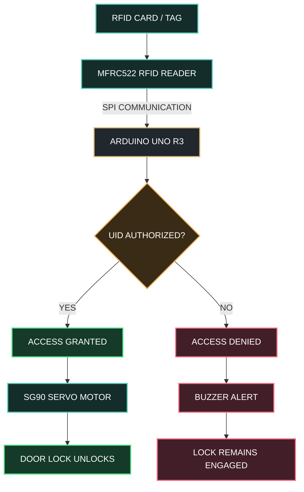

# ⬡ RFID SMART ACCESS CONTROL SYSTEM

### INTELLIGENT SECURITY • EMBEDDED SYSTEMS • AUTOMATED ACCESS

 

 

**SCAN → AUTHENTICATE → UNLOCK**

 

 

`ARDUINO UNO` &nbsp; • &nbsp; `MFRC522 RFID` &nbsp; • &nbsp; `SG90 SERVO` &nbsp; • &nbsp; `ACCESS CONTROL`

**Designed & Developed by Ahmed Bader Eddine Benkhira**

## ◈ 01 — PROJECT OVERVIEW

The **RFID Smart Access Control System** is an embedded security prototype designed to demonstrate contactless identification and automated access control using an Arduino UNO and an MFRC522 RFID reader.

When an RFID card is presented, the reader retrieves its unique identifier (UID). The Arduino compares it with a predefined list of authorized cards. If the UID is authorized, an SG90 servo motor moves the demonstration lock to its unlocked position. Otherwise, access is denied and an optional buzzer can provide an alert.

The project combines RFID communication, embedded C++, authentication logic, and electromechanical actuation in a compact access-control prototype.

---

## ◈ 02 — SYSTEM ARCHITECTURE

---

# Arduino-RFID-Door-Lock-System
An automated RFID-based physical security system engineered with Arduino UNO. Features a MFRC522 sensing interface for UID-validated entry and a servo-actuated locking mechanism for hands-free access control
#  RFID Smart Access Control System

      _________________________________________________
      |                                                |
      |          Arduino RFID Access Control           |
      |________________________________________________|
               |                                |
      [ RFID SCANNER ]                  [ SERVO MOTOR ]
      |    (MFRC522)   |                  |  (Lock Mech)  |
      |   __________   |                  |      ____     |
      |  |  ( (●) ) |  |       ____       |     /    \    |
      |  |   SCAN   |  |------|    |------|    | STOP |   |
      |  |   HERE   |  |      |UNO |      |     \____/    |
      |  |__________|  |      |____|      |      _||_     |
      |________________|        ||        |_____|____|____|
                                ||
                        [ BUZZER / LEDS ]
                         (Status Indicators)

          Key:   [*] Authorized Tag -> Servo Rotates (Open)
                 [!] Unauthorized   -> Buzzer Alarms (Locked)

                 

##  Project Overview
This project presents the design and implementation of a secure RFID-based access control system using Arduino UNO and MFRC522 RFID module.

The system grants access only to authorized RFID cards and controls a servo motor to simulate a door locking mechanism.

----------------------------------------------------------------------------------------------------------------
----------------------------------------------------------------------------------------------------------------
-----------------------------------ben khira ahmed bader eddine-------------------------------------------------
----------------------------------------------------------------------------------------------------------------
----------------------------------------------------------------------------------------------------------------

##  Hardware Components
- Arduino UNO
- MFRC522 RFID Reader (SPI)
- SG90 Servo Motor
- Buzzer (optional)
- RFID Cards / Tags
- Breadboard & Jumper Wires

----------------------------------------------------------------------------------------------------------------
----------------------------------------------------------------------------------------------------------------

##  System Architecture

1. RFID card is scanned
2. Arduino reads UID
3. UID is compared with authorized list
4. If matched → Door unlocks
5. If not matched → Access denied alert

----------------------------------------------------------------------------------------------------------------
----------------------------------------------------------------------------------------------------------------

##  Features
- Multi-card authentication
- Automatic re-lock after timeout
- Unauthorized access detection
- Modular structured code
- Expandable system design

----------------------------------------------------------------------------------------------------------------
----------------------------------------------------------------------------------------------------------------

##  Technologies Used
- C++ (Arduino IDE)
- Embedded Systems Programming
- SPI Communication Protocol
- Servo Motor Control

----------------------------------------------------------------------------------------------------------------
----------------------------------------------------------------------------------------------------------------
-----------------------------------ben khira ahmed bader eddine-------------------------------------------------
----------------------------------------------------------------------------------------------------------------
----------------------------------------------------------------------------------------------------------------

##  Future Improvements
- EEPROM-based dynamic card registration
- LCD display integration
- IoT remote monitoring (ESP32)
- Access logging system

----------------------------------------------------------------------------------------------------------------
----------------------------------------------------------------------------------------------------------------
-----------------------------------ben khira ahmed bader eddine-------------------------------------------------
----------------------------------------------------------------------------------------------------------------
----------------------------------------------------------------------------------------------------------------

##  Author
Ahmed Bader Eddine  
Bachelor Graduate  
GitHub: https://github.com/BenkhiraAhmedBaderEddine1
