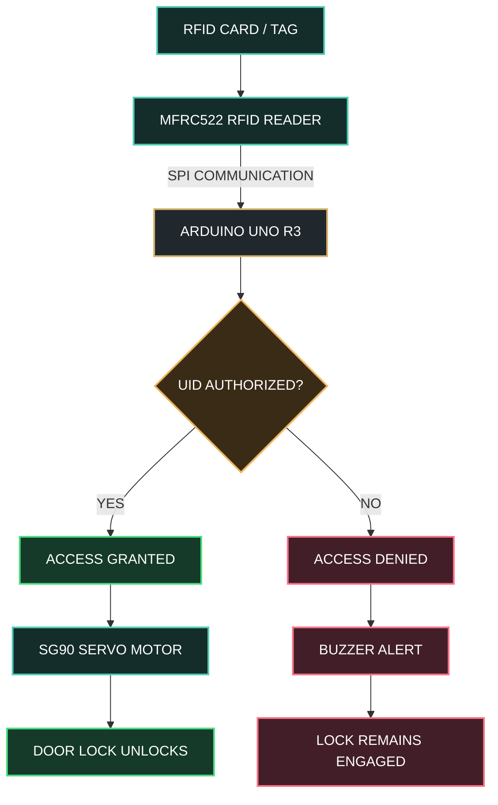
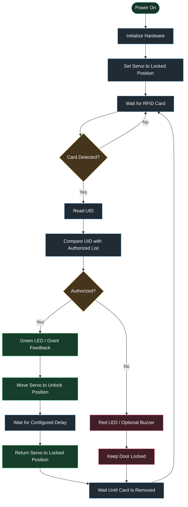
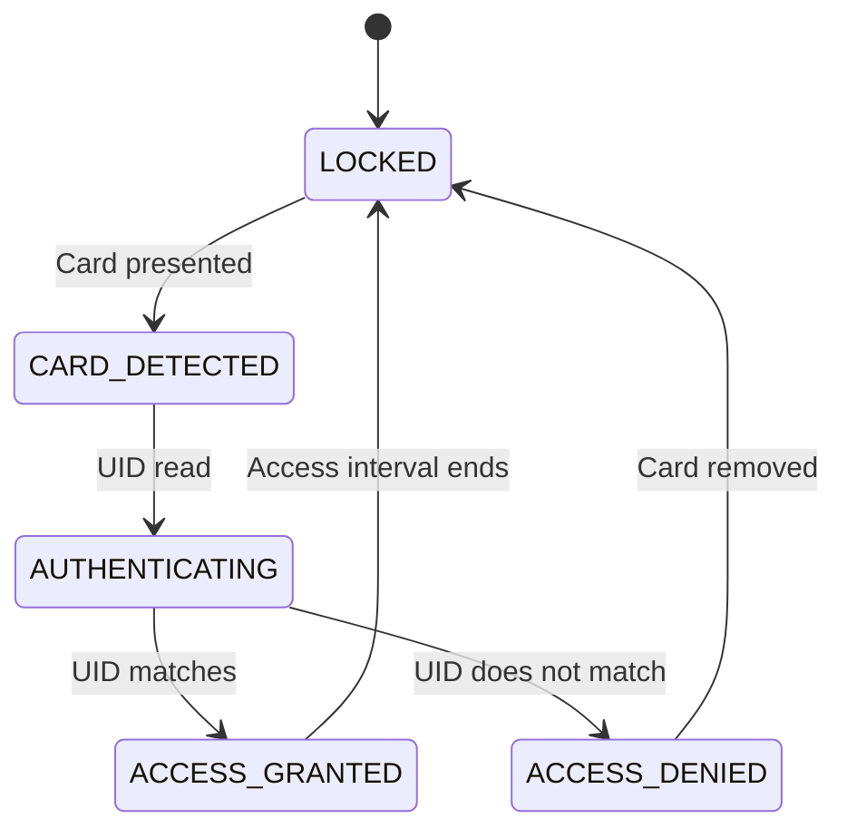
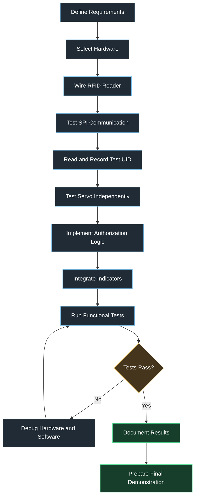

<div align="center">

# ⬡ RFID SMART ACCESS CONTROL SYSTEM

### INTELLIGENT SECURITY • EMBEDDED SYSTEMS • AUTOMATED ACCESS

<br>


<br>

**SCAN → AUTHENTICATE → UNLOCK**

<br>


<br>

`ARDUINO UNO` &nbsp; • &nbsp; `MFRC522 RFID` &nbsp; • &nbsp; `SG90 SERVO` &nbsp; • &nbsp; `ACCESS CONTROL`

**Designed & Developed by Ahmed Bader Eddine Benkhira**

<div align="center">



</div>


<!-- Premium Grey, Emerald Green & Gold Divider -->

<div align="center">
  
</div>
<!-- Premium Grey, Emerald Green & Gold Divider -->

<div align="center">
  
</div>

## ═══ 01 · PROJECT OVERVIEW ═══

<!-- Premium Grey, Emerald Green & Gold Divider -->

<div align="center">
  
</div>
<!-- Premium Grey, Emerald Green & Gold Divider -->

<div align="center">
  
</div>

### 1.1 Introduction

<!-- Premium Grey, Emerald Green & Gold Divider -->

<div align="center">
  
</div>


Access control is an essential component of modern security systems used in residential buildings, laboratories, offices, industrial facilities, and restricted areas. Traditional mechanical keys provide a simple method of entry, but they can be lost, duplicated, or transferred between individuals without centralized authorization.

The **RFID Smart Access Control System** introduces a contactless alternative based on Radio-Frequency Identification (RFID). The system enables a user to present an RFID card or tag to a reader installed near a door. A microcontroller reads the card identifier, evaluates it against a predefined authorization list, and determines whether access should be granted or denied.

An authorized card activates a servo motor that simulates the unlocking mechanism. An unauthorized card leaves the system locked and may trigger an audible warning through a buzzer.

The prototype is implemented using an Arduino UNO, an MFRC522 RFID reader, an SG90 servo motor, and optional status indicators. It combines hardware interfacing, embedded C++ programming, digital communication, state-based control, and experimental validation in one integrated engineering project.

### 1.2 Project Objectives

<!-- Premium Grey, Emerald Green & Gold Divider -->

<div align="center">
  
</div>


The primary objectives are:

- Develop a contactless identification system using RFID technology.
- Interface an MFRC522 reader with an Arduino UNO through SPI communication.
- Implement an authorization algorithm based on registered card identifiers.
- Control a servo motor to simulate door locking and unlocking.
- Provide feedback for successful and unsuccessful authentication.
- Evaluate response time, reliability, usability, and operational limitations.
- Establish a foundation for future enhancements involving secure credentials, event logging, and network connectivity.

### 1.3 Project Scope


<!-- Premium Grey, Emerald Green & Gold Divider -->

<div align="center">
  
</div>


This implementation focuses on a low-cost, educational access-control prototype. The servo represents a small locking mechanism or model door rather than a full-size physical security lock.

The baseline design operates locally without requiring an internet connection, cloud service, or external database.

---
<!-- Premium Grey, Emerald Green & Gold Divider -->

<div align="center">
  
</div>
<!-- Premium Grey, Emerald Green & Gold Divider -->

<div align="center">
  
</div>


## ═══ 02 · SYSTEM ARCHITECTURE ═══


<!-- Premium Grey, Emerald Green & Gold Divider -->

<div align="center">
  
</div>


### 2.1 High-Level Architecture

<!-- Premium Grey, Emerald Green & Gold Divider -->

<div align="center">
  
</div>


The system consists of four principal functional layers:

1. **Identification Layer:** The RFID card communicates with the MFRC522 reader.
2. **Processing Layer:** The Arduino reads the card UID and performs the authorization check.
3. **Actuation Layer:** The servo motor changes between locked and unlocked positions.
4. **Feedback Layer:** LEDs and an optional buzzer communicate the authentication result.



---


----------------------------------------------------------------------------------------------------------------
----------------------------------------------------------------------------------------------------------------
-----------------------------------ben khira ahmed bader eddine-------------------------------------------------
----------------------------------------------------------------------------------------------------------------
----------------------------------------------------------------------------------------------------------------


### 2.2 Operating Principle


<!-- Premium Grey, Emerald Green & Gold Divider -->

<div align="center">
  
</div>


The process begins when an RFID card enters the reader's operating field. The MFRC522 detects the card and obtains its identifier through the RFID protocol.

The Arduino receives the identifier, compares it with the configured list of authorized UIDs, and selects the corresponding response.

If the identifier matches an entry in the list, the controller activates the servo to simulate unlocking. After a configurable interval, the servo returns to its locked position.

If no match is found, the controller denies access and optionally activates a buzzer.

**Important:** The baseline implementation checks a card UID. It does not perform cryptographic card authentication, maintain a permanent audit trail, or guarantee protection against cloned cards.

---


<!-- Premium Grey, Emerald Green & Gold Divider -->

<div align="center">
  
</div>
<!-- Premium Grey, Emerald Green & Gold Divider -->

<div align="center">
  
</div>


## ═══ 03 · HARDWARE COMPONENTS ═══

<!-- Premium Grey, Emerald Green & Gold Divider -->

<div align="center">
  
</div>


### 3.1 Bill of Materials


<!-- Premium Grey, Emerald Green & Gold Divider -->

<div align="center">
  
</div>


| No. | Component | Quantity | Function |
|:--:|---|:--:|---|
| 1 | Arduino UNO R3 | 1 | Main microcontroller |
| 2 | MFRC522 RFID reader | 1 | Reads RFID cards and tags |
| 3 | Compatible RFID card or tag | 1+ | Contactless credential |
| 4 | SG90 servo motor | 1 | Simulates the locking mechanism |
| 5 | Active buzzer | 1 | Optional denial notification |
| 6 | Red LED | 1 | Optional access-denied indicator |
| 7 | Green LED | 1 | Optional access-granted indicator |
| 8 | 220–330 Ω LED resistors | 2 | Limit LED current |
| 9 | Breadboard | 1 | Prototype assembly |
| 10 | Jumper wires | As needed | Electrical connections |
| 11 | USB cable | 1 | Programming and power |
| 12 | External regulated supply | As required | Servo power when needed |

The exact number of components depends on the selected configuration. LEDs and the buzzer are optional additions.

### 3.2 Required Software


<!-- Premium Grey, Emerald Green & Gold Divider -->

<div align="center">
  
</div>


- Arduino IDE
- Arduino AVR board support
- `MFRC522` library
- `SPI` library
- `Servo` library
- USB serial monitor for diagnostics

### 3.3 Why These Components Were Selected


<!-- Premium Grey, Emerald Green & Gold Divider -->

<div align="center">
  
</div>


**Arduino UNO:** Provides a straightforward development platform with digital I/O, SPI communication, and a large embedded-development ecosystem.

**MFRC522:** Offers an affordable RFID reader interface suitable for educational prototypes using compatible 13.56 MHz cards and tags.

**SG90 Servo:** Provides simple angular positioning for a miniature door or locking model.

**Buzzer and LEDs:** Offer immediate feedback without requiring a display or network connection.

---


<!-- Premium Grey, Emerald Green & Gold Divider -->

<div align="center">
  
</div>
<!-- Premium Grey, Emerald Green & Gold Divider -->

<div align="center">
  
</div>


## ═══ 04 · CIRCUIT DESIGN AND PIN MAPPING ═══


<!-- Premium Grey, Emerald Green & Gold Divider -->

<div align="center">
  
</div>
### 4.1 MFRC522 to Arduino UNO
<!-- Premium Grey, Emerald Green & Gold Divider -->

<div align="center">
  
</div>


| MFRC522 Pin | Arduino UNO Pin | Purpose |
|---|---|---|
| SDA / SS | D10 | SPI chip select |
| SCK | D13 | SPI clock |
| MOSI | D11 | SPI data from Arduino to reader |
| MISO | D12 | SPI data from reader to Arduino |
| RST | D9 | Reader reset |
| GND | GND | Common ground |
| 3.3V | 3.3V | Reader supply |

**Voltage warning:** The MFRC522 module is a 3.3 V device. Do not connect its supply pin to 5 V. Verify the electrical specifications of the particular module and use appropriate logic-level conversion where required.

### 4.2 Servo, LEDs, and Buzzer


<!-- Premium Grey, Emerald Green & Gold Divider -->

<div align="center">
  
</div>


| Component | Arduino Pin | Connection |
|---|---|---|
| SG90 signal | D6 | PWM-capable digital pin |
| Green LED | D4 | LED through a current-limiting resistor |
| Red LED | D5 | LED through a current-limiting resistor |
| Buzzer signal | D3 | Compatible active buzzer input |
| Servo power | Appropriate regulated supply | According to servo specifications |
| Servo ground | GND | Common reference with Arduino |

The servo power arrangement must be appropriate for its current demand. An external regulated supply may be necessary. Connect the external supply ground to the Arduino ground.

Do not assume that the Arduino's onboard regulator or USB connection can safely supply every servo load.
<!-- Premium Grey, Emerald Green & Gold Divider -->


### 4.3 Electrical Design Considerations


<!-- Premium Grey, Emerald Green & Gold Divider -->

<div align="center">
  
</div>


- Confirm the MFRC522 module's supply voltage before powering the circuit.
- Keep signal and power wiring short during initial testing.
- Avoid drawing excessive current from Arduino GPIO pins.
- Use a suitable resistor for each LED.
- Check servo current demand, especially during startup or mechanical resistance.
- Keep the RFID reader away from large metal surfaces when possible.
- Test the circuit with the servo disconnected before integrating the actuator.

---


<!-- Premium Grey, Emerald Green & Gold Divider -->

<div align="center">
  
</div>
<!-- Premium Grey, Emerald Green & Gold Divider -->

<div align="center">
  
</div>


## ═══ 05 · CONTROL ALGORITHM ═══


<!-- Premium Grey, Emerald Green & Gold Divider -->

<div align="center">
  
</div>
### 5.1 Authentication Logic


<!-- Premium Grey, Emerald Green & Gold Divider -->

<div align="center">
  
</div>


 
The controller follows a deterministic decision process:

1. Initialize the serial interface, SPI bus, RFID reader, servo, and output indicators.
2. Set the servo to its configured locked position.
3. Wait for a compatible RFID card or tag.
4. Read the card UID.
5. Compare the UID against the authorized credential list.
6. If a match is found, activate the grant indication and unlock the model door.
7. Wait for the configured access interval.
8. Return the servo to the locked position.
9. If the UID is not authorized, keep the door locked and activate the denial indication.
10. Stop processing the current card until it has been removed, then continue monitoring.
thub.com/BenkhiraAhmedBaderEddine1
<!-- Premium Grey, Emerald Green & Gold Divider -->

<div align="center">
  
</div>

### 5.2 Authentication Flowchart

<!-- Premium Grey, Emerald Green & Gold Divider -->

<div align="center">
  
</div>

```
### 5.3 State Machine

The system can be represented by five logical states:

| State | Description | Expected Behavior |
|---|---|---|
| `LOCKED` | Default condition | Door remains locked |
| `CARD_DETECTED` | RFID credential detected | Read the UID |
| `AUTHENTICATING` | Authorization check | Compare the UID |
| `ACCESS_GRANTED` | Authorized UID | Unlock temporarily |
| `ACCESS_DENIED` | Unauthorized UID | Maintain locked condition |



This state model separates identification, decision-making, and actuation. It also provides a foundation for adding timeouts, fault detection, and event logging.

---
<!-- Premium Grey, Emerald Green & Gold Divider -->

<div align="center">
  
</div>
<!-- Premium Grey, Emerald Green & Gold Divider -->

<div align="center">
  
</div>
## ═══ 06 · ARDUINO IMPLEMENTATION ═══
<!-- Premium Grey, Emerald Green & Gold Divider -->

<div align="center">
  
</div>
### 6.1 Complete Baseline Sketch
<!-- Premium Grey, Emerald Green & Gold Divider -->

<div align="center">
  
</div>
The following sketch implements the core prototype. Replace the example UID with the UID of a card you control, obtained from the Serial Monitor.

Install the `MFRC522` library before compiling.

```cpp
#include <SPI.h>
#include <MFRC522.h>
#include <Servo.h>

// ---------------- PIN CONFIGURATION ----------------

constexpr byte RFID_SS_PIN = 10;
constexpr byte RFID_RST_PIN = 9;

constexpr byte SERVO_PIN = 6;
constexpr byte GREEN_LED_PIN = 4;
constexpr byte RED_LED_PIN = 5;
constexpr byte BUZZER_PIN = 3;

// ---------------- SERVO CONFIGURATION ---------------

constexpr int LOCKED_ANGLE = 0;
constexpr int UNLOCKED_ANGLE = 90;

constexpr unsigned long UNLOCK_DURATION_MS = 5000;

// ---------------- HARDWARE OBJECTS ------------------

MFRC522 rfid(RFID_SS_PIN, RFID_RST_PIN);
Servo doorServo;

// Replace this example with your own card UID.
// The number of bytes must match the actual card UID.

const byte AUTHORIZED_UID[] = {
    0xDE, 0xAD, 0xBE, 0xEF
};

constexpr byte AUTHORIZED_UID_LENGTH =
    sizeof(AUTHORIZED_UID) / sizeof(AUTHORIZED_UID[0]);

// ---------------- ACCESS CONTROL --------------------

bool accessGranted(const MFRC522::Uid &uid) {
    if (uid.size != AUTHORIZED_UID_LENGTH) {
        return false;
    }

    for (byte i = 0; i < AUTHORIZED_UID_LENGTH; i++) {
        if (uid.uidByte[i] != AUTHORIZED_UID[i]) {
            return false;
        }
    }

    return true;
}

void setLockedState() {
    doorServo.write(LOCKED_ANGLE);

    digitalWrite(GREEN_LED_PIN, LOW);
    digitalWrite(RED_LED_PIN, LOW);

    Serial.println(F("SYSTEM: DOOR LOCKED"));
}

void indicateDenied() {
    digitalWrite(GREEN_LED_PIN, LOW);
    digitalWrite(RED_LED_PIN, HIGH);

    // Optional active buzzer notification.
    digitalWrite(BUZZER_PIN, HIGH);
    delay(250);
    digitalWrite(BUZZER_PIN, LOW);

    Serial.println(F("ACCESS DENIED"));
    Serial.println(F("Door remains locked."));

    delay(500);
    digitalWrite(RED_LED_PIN, LOW);
}

void unlockDoor() {
    digitalWrite(RED_LED_PIN, LOW);
    digitalWrite(GREEN_LED_PIN, HIGH);

    Serial.println(F("ACCESS GRANTED"));
    Serial.println(F("Unlocking door..."));

    doorServo.write(UNLOCKED_ANGLE);

    delay(UNLOCK_DURATION_MS);

    setLockedState();
}

// ---------------- UID DISPLAY -----------------------

void printUID(const MFRC522::Uid &uid) {
    Serial.print(F("Card UID: "));

    for (byte i = 0; i < uid.size; i++) {
        if (uid.uidByte[i] < 0x10) {
            Serial.print('0');
        }

        Serial.print(uid.uidByte[i], HEX);

        if (i < uid.size - 1) {
            Serial.print(' ');
        }
    }

    Serial.println();
}

// ---------------- SETUP -----------------------------

void setup() {
    Serial.begin(9600);

    pinMode(GREEN_LED_PIN, OUTPUT);
    pinMode(RED_LED_PIN, OUTPUT);
    pinMode(BUZZER_PIN, OUTPUT);

    digitalWrite(GREEN_LED_PIN, LOW);
    digitalWrite(RED_LED_PIN, LOW);
    digitalWrite(BUZZER_PIN, LOW);

    doorServo.attach(SERVO_PIN);
    doorServo.write(LOCKED_ANGLE);

    SPI.begin();
    rfid.PCD_Init();

    delay(100);

    Serial.println(F("----------------------------------"));
    Serial.println(F(" RFID SMART ACCESS CONTROL SYSTEM"));
    Serial.println(F("----------------------------------"));
    Serial.println(F("Present an RFID card to the reader."));

    rfid.PCD_DumpVersionToSerial();
}

// ---------------- MAIN LOOP -------------------------

void loop() {
    // Wait for a new card.
    if (!rfid.PICC_IsNewCardPresent()) {
        return;
    }

    // Read the card UID.
    if (!rfid.PICC_ReadCardSerial()) {
        return;
    }

    printUID(rfid.uid);

    if (accessGranted(rfid.uid)) {
        unlockDoor();
    } else {
        indicateDenied();
    }

    // Stop communication with the current card.
    rfid.PICC_HaltA();
    rfid.PCD_StopCrypto1();

    // Wait until the card is removed so it is not
    // immediately processed repeatedly.
    while (rfid.PICC_IsNewCardPresent()) {
        delay(50);
    }

    delay(150);
}
```

### 6.2 Important Code Configuration
<!-- Premium Grey, Emerald Green & Gold Divider -->

<div align="center">
  
</div>

**Authorized UID:** The sketch contains a demonstration UID, `DE AD BE EF`. This is a placeholder, not a real credential. Use the UID printed by your reader and confirm its byte length.

**Servo angles:** The example assumes `0°` is locked and `90°` is unlocked. The correct angles depend on your mechanical arrangement. Adjust them carefully.

**Buzzer:** The code assumes a compatible active buzzer that can be driven safely by the chosen interface. Use a driver transistor if the buzzer's electrical requirements exceed the GPIO capability.

**Access duration:** `UNLOCK_DURATION_MS` defines how long the servo remains in the unlocked position.

**Security limitation:** UID matching is suitable for demonstrating the workflow, but it is not strong authentication. Some RFID credentials can be copied or emulated. Do not use this implementation as the sole security mechanism for a real building.

### 6.3 Suggested Serial Output
<!-- Premium Grey, Emerald Green & Gold Divider -->

<div align="center">
  
</div>

An example of the expected diagnostic output is:

```text
----------------------------------
 RFID SMART ACCESS CONTROL SYSTEM
----------------------------------
Present an RFID card to the reader.

Card UID: 12 34 56 78
ACCESS GRANTED
Unlocking door...
SYSTEM: DOOR LOCKED

Card UID: AA BB CC DD
ACCESS DENIED
Door remains locked.
```

The UID values above are illustrative. Actual identifiers depend on the cards used.

---
<!-- Premium Grey, Emerald Green & Gold Divider -->

<div align="center">
  
</div><!-- Premium Grey, Emerald Green & Gold Divider -->

<div align="center">
  
</div>
## ═══ 07 · DEVELOPMENT WORKFLOW ═══
<!-- Premium Grey, Emerald Green & Gold Divider -->

<div align="center">
  
</div>
### 7.1 Step-by-Step Construction
<!-- Premium Grey, Emerald Green & Gold Divider -->

<div align="center">
  
</div>
**Phase 1 — Hardware Preparation**

Collect the Arduino UNO, MFRC522 module, RFID cards, servo motor, breadboard, jumper wires, and optional indicators. Inspect the components and verify the reader's voltage requirements.

**Phase 2 — Reader Integration**

Connect the MFRC522 to the Arduino using the SPI pins. Upload a basic reader test sketch and verify that the module initializes correctly.

**Phase 3 — Credential Identification**

Use the Serial Monitor to display card UIDs. Record the UID of the test card you control and update the authorization array in the program.

**Phase 4 — Actuator Testing**

Connect the servo using an appropriate power arrangement. Test the locked and unlocked angles independently before combining it with the reader.

**Phase 5 — Authentication Logic**

Integrate the UID comparison function and test both authorized and unauthorized cards.

**Phase 6 — User Feedback**

Add the LEDs and optional buzzer. Confirm that the indications match the system's decision.

**Phase 7 — Integrated Validation**
<!-- Premium Grey, Emerald Green & Gold Divider -->

Repeat tests with different cards, repeated presentations, power cycles, and different mechanical positions. Document the observed behavior and any failures.

### 7.2 Recommended Build Sequence
<!-- Premium Grey, Emerald Green & Gold Divider -->

<div align="center">
  
</div>





<!-- Premium Grey, Emerald Green & Gold Divider -->

<div align="center">
  
</div>
<!-- Premium Grey, Emerald Green & Gold Divider -->

<div align="center">
  
</div>
## ═══ 08 · TESTING AND VALIDATION ═══

<!-- Premium Grey, Emerald Green & Gold Divider -->

<div align="center">
  
</div>

### 8.1 Functional Test Plan

<!-- Premium Grey, Emerald Green & Gold Divider -->

<div align="center">
  
</div>


| Test ID | Test Scenario | Expected Result |
|---|---|---|
| T01 | Power on the system | Reader initializes; servo starts locked |
| T02 | Present an authorized card | Access granted |
| T03 | Present an unauthorized card | Access denied |
| T04 | Present a card with a different UID length | Access denied |
| T05 | Remove and present the same card again | A new scan is processed |
| T06 | Disconnect the RFID reader | Fault is investigated; normal operation cannot be assumed |
| T07 | Power-cycle the prototype | The configured authorization list remains available in firmware |
| T08 | Move the servo under normal conditions | The actuator reaches its configured positions |
| T09 | Repeat scans rapidly | No unintended repeated unlock should occur |
| T10 | Test the power supply under servo load | Supply remains within component specifications |

The expected results describe test objectives, not measured outcomes. Mark each test as passed or failed only after performing it on the actual hardware.

### 8.2 Performance Metrics


<!-- Premium Grey, Emerald Green & Gold Divider -->

<div align="center">
  
</div>


A master-level evaluation should measure the following:

- **Authentication response time:** Time between presenting a card and receiving a decision.
- **Actuation latency:** Time between authorization and the servo reaching its intended position.
- **Recognition reliability:** Percentage of valid test presentations correctly recognized.
- **False acceptance:** Number of unauthorized test presentations incorrectly granted access.
- **False rejection:** Number of authorized test presentations incorrectly denied.
- **Power consumption:** Current and voltage under idle, scanning, and servo-actuation conditions.
- **Recovery behavior:** System behavior after resets, communication errors, and power interruptions.

Useful metrics can be calculated as follows:

\[
\text{Recognition Rate} =
\frac{\text{Correct Recognitions}}
{\text{Total Valid Test Presentations}}
\times 100\%
\]

\[
\text{False Rejection Rate} =
\frac{\text{Authorized Attempts Denied}}
{\text{Total Authorized Attempts}}
\times 100\%
\]

\[
\text{False Acceptance Rate} =
\frac{\text{Unauthorized Attempts Granted}}
{\text{Total Unauthorized Attempts}}
\times 100\%
\]

Report the test count, environment, card types, and measured values alongside each percentage. A small prototype test is not sufficient to establish the security of a deployed access-control system.

### 8.3 Experimental Results Template


<!-- Premium Grey, Emerald Green & Gold Divider -->

<div align="center">
  
</div>


Complete this table after testing the physical prototype.


| Parameter | Measurement |
|---|---|
| Number of authorized test scans | To be measured |
| Number of unauthorized test scans | To be measured |
| Average authentication latency | To be measured |
| Average servo actuation time | To be measured |
| Recognition rate | To be calculated |
| False acceptance observations | To be recorded |
| False rejection observations | To be recorded |
| Idle current | To be measured |
| Servo operating current | To be measured |

**Engineering note:** Do not report simulated, estimated, or expected values as experimental measurements.


---
<!-- Premium Grey, Emerald Green & Gold Divider -->

<div align="center">
  
</div>
<!-- Premium Grey, Emerald Green & Gold Divider -->

<div align="center">
  
</div>


## ═══ 09 · SECURITY ANALYSIS ═══


<!-- Premium Grey, Emerald Green & Gold Divider -->

<div align="center">
  
</div>


### 9.1 Threat Model


<!-- Premium Grey, Emerald Green & Gold Divider -->

<div align="center">
  
</div>


An access-control prototype should be evaluated against several possible failure and attack scenarios.


| Threat | Baseline Exposure | Recommended Mitigation |
|---|---|---|
| Lost RFID card | Card may remain authorized | Revoke lost credentials |
| UID copying or emulation | UID-only comparison may be bypassed | Use credentials with suitable cryptographic authentication |
| Unauthorized firmware changes | Authorization logic may be altered | Restrict programming access and protect firmware |
| Power interruption | Actuator may stop in an uncertain state | Define and verify safe mechanical behavior |
| Servo obstruction | Commanded position may not be reached | Add position sensing or lock-state feedback |
| Reader disconnection | Scanning may stop | Detect faults and keep access denied |
| Repeated presentation | Repeated processing may occur | Add explicit state management and event handling |
| Credential-list exposure | Firmware may reveal authorized UIDs | Use protected credential storage and stronger authentication |

### 9.2 Security Limitations


<!-- Premium Grey, Emerald Green & Gold Divider -->

<div align="center">
  
</div>


The baseline project uses an allowlist of card UIDs stored in firmware. It does not prove the identity of the cardholder and does not provide strong cryptographic authentication.

A UID is an identifier, not a secret. Depending on the credential, it may be possible to reproduce or emulate it. The MFRC522 and compatible card combination should therefore be treated as an educational RFID platform, not as a complete security boundary.

A production design would require a security assessment, suitable cryptographic credentials, protected key management, secure credential enrollment and revocation, fault monitoring, and a mechanically appropriate lock.

### 9.3 Safety and Fail-Secure Considerations


<!-- Premium Grey, Emerald Green & Gold Divider -->

<div align="center">
  
</div>


The servo's last commanded angle does not prove that a physical door is locked. A blocked, disconnected, or underpowered servo may fail to reach its target.

For a real installation, the locking mechanism, power-loss behavior, emergency egress, fire regulations, and applicable building requirements must be evaluated independently.

---


<!-- Premium Grey, Emerald Green & Gold Divider -->

<div align="center">
  
</div>
<!-- Premium Grey, Emerald Green & Gold Divider -->

<div align="center">
  
</div>


## ═══ 10 · ADVANTAGES AND LIMITATIONS ═══


<!-- Premium Grey, Emerald Green & Gold Divider -->

<div align="center">
  
</div>
### 10.1 Advantages
<!-- Premium Grey, Emerald Green & Gold Divider -->

<div align="center">
  
</div>


- **Contactless interaction:** Users do not need to insert a mechanical key.
- **Low implementation cost:** The prototype uses widely available educational components.
- **Modular architecture:** The reader, controller, indicators, and actuator can be tested separately.
- **Fast local decisions:** Authorization is evaluated on the microcontroller without a network dependency.
- **Expandable software:** The code can be extended with credential management and event logging.
- **Educational value:** The project combines electronics, embedded C++, communication protocols, and control logic.
- **Demonstrable operation:** The card scan, decision, and servo response are easy to observe during a presentation.

### 10.2 Limitations


<!-- Premium Grey, Emerald Green & Gold Divider -->

<div align="center">
  
</div>


- **Weak baseline authentication:** UID comparison alone is not adequate for high-security applications.
- **Limited credential management:** The demonstration uses a UID configured in firmware.
- **No built-in audit database:** The baseline sketch does not retain a permanent access history.
- **No remote monitoring:** Network connectivity is not included.
- **Mechanical limitations:** The SG90 is designed for small hobby applications, not full-size security doors.
- **Power sensitivity:** Servo startup and load current can affect system stability.
- **Limited fault detection:** The baseline does not independently verify the physical lock position.
- **Hardware dependence:** Reader performance and compatibility vary with cards, modules, wiring, and environmental conditions.

### 10.3 Comparative Assessment


<!-- Premium Grey, Emerald Green & Gold Divider -->

<div align="center">
  
</div>


| Feature | Baseline Prototype | Enhanced Design |
|---|---|---|
| Identification | RFID UID | Cryptographic credential authentication |
| Authorization | Firmware allowlist | Managed credential database |
| Event history | Serial output only | Persistent, access-controlled audit log |
| Connectivity | Standalone | Optional network or local management interface |
| Actuator feedback | Servo command | Independent lock-position sensor |
| Fault monitoring | Basic | Explicit diagnostics and safe-state handling |
| Credential revocation | Firmware update | Controlled enrollment and revocation workflow |

---

## ═══ 11 · FUTURE DEVELOPMENT ROADMAP ═══

### Phase I — Core Reliability

- Improve handling of repeated card scans.
- Add clear initialization and fault messages.
- Validate servo angles and power requirements.
- Add systematic functional testing.

### Phase II — Credential Management

- Support multiple authorized credentials.
- Add a controlled enrollment and revocation process.
- Store configuration using an appropriate persistence mechanism.
- Validate stored data and define behavior after corrupted or missing data.

### Phase III — User Interface and Logging

- Add an LCD or OLED display.
- Display clear granted and denied messages.
- Add a real-time clock if timestamps are required.
- Record access events in appropriately protected storage.

### Phase IV — Connected Access Control

- Consider an ESP32-based version for network connectivity.
- Add a local administrative interface with authentication.
- Protect communications and management credentials.
- Implement access logging and monitoring with suitable privacy controls.

### Phase V — Security and Physical Integration

- Evaluate cryptographic RFID credentials and key management.
- Add lock-position sensing and actuator fault detection.
- Test power-loss and restart behavior.
- Assess the complete mechanical and electrical installation.
- Conduct documented security and reliability testing.

---


<!-- Premium Grey, Emerald Green & Gold Divider -->

<div align="center">
  
</div>
<!-- Premium Grey, Emerald Green & Gold Divider -->

<div align="center">
  
</div>


## ═══ 12 · TROUBLESHOOTING GUIDE ═══


<!-- Premium Grey, Emerald Green & Gold Divider -->

<div align="center">
  
</div>


| Problem | Possible Cause | Recommended Check |
|---|---|---|
| RFID reader not detected | Incorrect wiring or supply | Verify 3.3 V, GND, SPI pins, and reset connection |
| UID is not displayed | Card incompatibility or failed communication | Test a compatible card and inspect Serial Monitor output |
| Valid card is denied | UID mismatch or incorrect byte order | Compare the printed UID with the configured array |
| Servo does not move | Incorrect signal pin or insufficient power | Verify D6 and the servo power arrangement |
| Arduino resets during movement | Supply voltage drop or excessive current | Test with a suitable regulated servo supply |
| LEDs do not illuminate | Incorrect polarity or wiring | Check LED orientation, resistor, and pin assignment |
| Buzzer remains silent | Wrong buzzer type or wiring | Confirm the buzzer's electrical requirements |
| Card is processed repeatedly | Card-removal handling is insufficient | Improve the state machine and reader event handling |
| Reader works intermittently | Wiring, interference, or power instability | Shorten wiring and test a stable power source |

---


<!-- Premium Grey, Emerald Green & Gold Divider -->

<div align="center">
  
</div>
<!-- Premium Grey, Emerald Green & Gold Divider -->

<div align="center">
  
</div>


## ═══ 13 · ACADEMIC CONTRIBUTION ═══


<!-- Premium Grey, Emerald Green & Gold Divider -->

<div align="center">
  
</div>


### 13.1 Engineering Concepts Demonstrated


<!-- Premium Grey, Emerald Green & Gold Divider -->

<div align="center">
  
</div>


This project demonstrates the integration of several engineering disciplines:

- Embedded-system design and microcontroller programming.
- Digital communication using the SPI bus.
- RFID-based identification and credential comparison.
- Finite-state-machine modeling.
- Electromechanical actuation using a servo motor.
- Human-machine feedback through indicators and serial diagnostics.
- Functional test design and quantitative performance evaluation.
- Security threat modeling and engineering risk analysis.

### 13.2 Suggested Master-Level Extensions


<!-- Premium Grey, Emerald Green & Gold Divider -->

<div align="center">
  
</div>


To elevate the project beyond a basic demonstration, the next stage should include a documented experimental study rather than additional features alone.

Recommended research questions include:

1. How does card-reader distance affect recognition reliability?
2. How does repeated scanning influence response time?
3. What power-supply conditions cause servo-related resets?
4. How does a state-machine implementation improve fault handling?
5. What security improvements result from moving beyond UID-only authorization?
6. How effectively can the system detect a mismatch between the commanded and actual lock state?

A strong academic submission should include a circuit diagram, implementation details, a justified design methodology, measured experimental results, error analysis, security considerations, and a discussion of limitations.

---


<!-- Premium Grey, Emerald Green & Gold Divider -->

<div align="center">
  
</div>
<!-- Premium Grey, Emerald Green & Gold Divider -->

<div align="center">
  
</div>


## ═══ 14 · CONCLUSION ═══


<!-- Premium Grey, Emerald Green & Gold Divider -->

<div align="center">
  
</div>

The RFID Smart Access Control System provides a practical foundation for studying contactless identification and embedded access-control logic. By combining an MFRC522 reader, Arduino UNO, RFID credentials, and a servo-actuated model door, the prototype demonstrates how a physical input can trigger a verified software decision and a corresponding electromechanical response.

The project also illustrates an important engineering principle: a successful demonstration is not equivalent to a production-ready security system. Reliable deployment requires stronger credential authentication, careful power and mechanical design, fault detection, and systematic validation.

The proposed development roadmap provides a path from a simple classroom prototype toward a more thoroughly tested, maintainable, and security-conscious access-control platform.

---

<div align="center">

### ⟡ ENGINEERED FOR LEARNING. DESIGNED FOR EXTENSION. ⟡

**RFID • EMBEDDED SYSTEMS • AUTOMATION • ACCESS CONTROL**

*Academic Prototype — Arduino UNO + MFRC522 + SG90*

</div>
